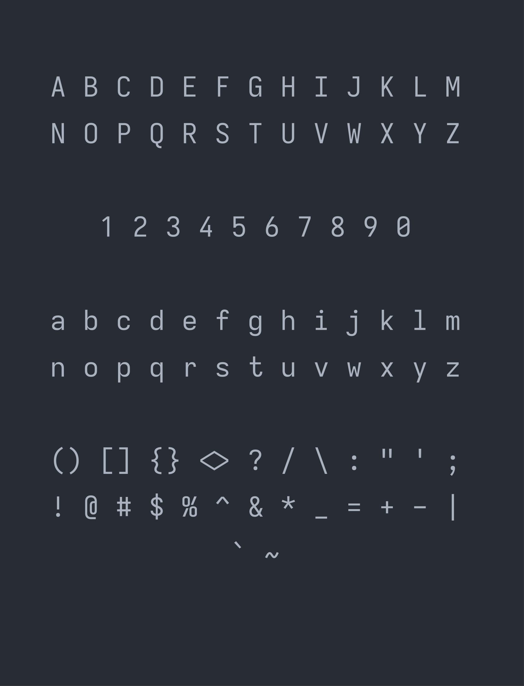

# Iosevka Extended

<p align="center">
  
</p>

> [!NOTE]
> More screenshots of the font in different programming and markup languages are in the [assets](https://github.com/Sunhaloo/IosevkaExtended/tree/main/assets) folder.

## Backstory

I pretty much live inside the terminal doing everything from running simple commands to even writing code using terminal text editors such as [Neovim](https://neovim.io/). This means that I spent most of my time looking at _characters_ on my screen and I have been looking for a good, high-quality, readable, font since I started working in the terminal.

Therefore, for most of my ( terminal ) life; I have been using one of the most popular ( _if not the most popular_ ) font in the world, [JetBrains Mono](https://www.jetbrains.com/lp/mono/) by... Well [JetBrains](https://www.jetbrains.com/)!

Then I started playing around and came across the many many fonts, and each of them were cool in their own way... Here are a small selection of fonts that I have extensively used ( _in order of time spent with them_ ):

1. [JetBrains Mono](https://www.jetbrains.com/lp/mono/)
2. [Iosevka](https://typeof.net/Iosevka/)
3. [IBM Plex Mono](https://www.ibm.com/plex/)
4. [Fira Code](https://github.com/tonsky/FiraCode)
5. [Geist Mono](https://vercel.com/font?type=mono)
6. [Operator Mono](https://typography.com/fonts/operator/overview)
7. [GitHub's Monospace ( Krypton, Radon, Neon )](https://monaspace.githubnext.com/)
8. [Victor Mono](https://rubjo.github.io/victor-mono/)
9. [Departure Mono](https://departuremono.com/)
10. [Terminus Font](https://terminus-font.sourceforge.net/)

> And I came across many more "_exotic_" in my time trying to search for a _**balanced**_ font!

Out of the above list, I mostly switched between 'JetBrains Mono' and 'Iosevka' as I think that the creators knew what they are doing when it comes to making good looking, readable fonts. But I always wanted to **merge** the two together in order to create a better balanced font.

> Imagine this, the width of JetBrainsMono combined with the character shapes of Iosevka... Man that would look so good.

I was casually browsing [programmingfonts.org](https://programmingfonts.org/), as one usually does on a random Wednesday night and looking at the same fonts again and again trying to pick a new font for my terminal and [Obsidian](https://obsidian.md/)... I came across [Iosevka Extended](https://www.programmingfonts.org/#iosevka-extended). My god it was "_love at first font_"!

> Brother what do you expect of me; never kissed a woman in my life...

Hence, I tried to find a downloadable version of it, tried my hardest to find the **official download page** but alas, I simply could not find it. Even though on the official Iosevka website; they do allow you to _try_ the _extended_ version of it but man, where the hell is the download link / button! Additionally, I only see that the `.ttc` version is available on their GitHub [releases page](https://github.com/be5invis/Iosevka/releases).

Thus, I decided to take matters into my own hands and to use the [online customiser](https://typeof.net/Iosevka/customizer) to create the `private-build-plans.toml` file and build the extended version **manually**!

## Download The Correct Font

In the [releases](https://github.com/Sunhaloo/IosevkaExtended/releases/) page, you are going to see that we have 3 different types of font.

All 3 downloads come with 27 styles with 9 _weights_ and 3 _slopes_ but **only** a _single width_.

> This is because I don't really need the other widths. Which means that we can keep things light!

| Font Type                                 | Best For                                                                   | Download                                                                                                      |
| ----------------------------------------- | -------------------------------------------------------------------------- | ------------------------------------------------------------------------------------------------------------- |
| <code>IosevkaExtended-Hinted.zip</code>   | Main font. Crisp edges on low resolution screens ( `ttfautohint` applied ) | [Download](https://github.com/Sunhaloo/IosevkaExtended/releases/latest/download/IosevkaExtended-Hinted.zip)   |
| <code>IosevkaExtended-Unhinted.zip</code> | High resolution / high-DPI monitors. Smaller file size                     | [Download](https://github.com/Sunhaloo/IosevkaExtended/releases/latest/download/IosevkaExtended-Unhinted.zip) |
| <code>IosevkaExtended-Web.zip</code>      | `WOFF2` web fonts for websites                                             | [Download](https://github.com/Sunhaloo/IosevkaExtended/releases/latest/download/IosevkaExtended-Web.zip)      |

> [!WARNING]
> Install **only one** of the Hinted or Unhinted sets, as both use the same family name and **will** conflict.

## Installation

### Linux

> [!WARNING]
> As mentioned above, you either choose to install the **hinted** version _or_ the **unhinted** one.
>
> Additionally, you can choose to install the fonts "_system-wide_" or "_user-wide_". Here also you choose only **one** installation method!
>
> > "_But why do I choose_?" I hear you ask!
>
> Well basically, if you have `sudo` / root access to your machine; simply install it however you like ( _you can either choose 'system-wide' or even 'user-wide'_ ).
>
> Nevertheless, if you **don't** have access to `sudo`'s password or you have **limited permissions**. You will be **forced** to use the '_user-wide_' installation method.
>
> Or if you simply want a _per-user_ install!

> [!TIP]
> If you have installed it in **both** places which is not ideal... Then you are going to have to run the following commands in order to check which is being currently used.
>
> ```bash
> # check which directory the font is being sourced
> fc-match -v "Iosevka Extended" | grep -E "file|fontversion"
> ```
>
> Depending on what is being used; you _could_ delete the one that is being ignored.
>
> As it's based on your output; I will **not** provide any commands here!

- Unzip the downloaded `.zip` file:

```bash
# assuming that you are inside the `~/Downloads` directory
# whereby the `<type>` is either the 'Hinted' or 'Unhinted' version
unzip IosevkaExtended-<type>.zip
```

- **User-wide** installation:

```bash
# create the user fonts directory
# INFO: nothing happens if you already have the directory ( safe to run )
mkdir -p ~/.local/share/fonts

# assuming that you are inside the `~/Downloads` directory
cp -r IosevkaExtended ~/.local/share/fonts/

# make the system know that we have added another font
fc-cache -fv

# verify that the font is present on the system
# INFO: you should get '27' as the output
fc-list | grep -i "Iosevka Extended" | wc -l

# ( optional ) delete the unwanted files
rm -rf IosevkaExtended-<type>.zip IosevkaExtended
```

- **System-wide** installation:

```bash
# assuming that you are inside the `~/Downloads` directory
sudo cp -r IosevkaExtended /usr/share/fonts/

# make the system know that we have added another font
fc-cache -fv

# verify that the font is present on the system
# INFO: you should get '27' as the output
fc-list | grep -i "Iosevka Extended" | wc -l

# ( optional ) delete the unwanted files
rm -rf IosevkaExtended-<type>.zip IosevkaExtended
```

### Windows

- Extract the downloaded `.zip` file using Windows' extract tool ( _or [7-zip](https://www.7-zip.org/)_ )
- Open the extracted folder and head inside the `IosevkaExtended-<type>\IosevkaExtended` folder
- Select all the `*.ttf` files present and you can either:
  - Install it for **yourself** if you **don't** have any administrator permissions
  - Install it for **everyone** if you **do** have administrator permissions
- Optionally, delete the `.zip` file and the extracted `IosevkaExtended-<type>` folder

## Usage

### Kitty Terminal

```conf
font_family      family="Iosevka Extended"
bold_font        auto
italic_font      auto
bold_italic_font auto
font_size        14.0
```

> [!TIP]
> If you want to customise the fonts additionally or setup the font dynamically.
>
> Feel free to use the `kitty list-fonts` or `kitten choose-fonts` command in order to have more granular control over the styling options.

### Ghostty Terminal

```config
font-family = "Iosevka Extended"
font-size = 14
```

### Zed Editor

```json
{
  "ui_font_family": "Iosevka Extended",
  "buffer_font_family": "Iosevka Extended",
  "ui_font_size": 14,
  "buffer_font_size": 14,
  "buffer_font_features": {
    "calt": true
  }
}
```

### Visual Studio Code ( VS Code )

```json
{
  "editor.fontFamily": "'Iosevka Extended', monospace",
  "terminal.integrated.fontFamily": "'Iosevka Extended', monospace",
  "editor.fontLigatures": true,
  "editor.fontSize": 14
}
```

---

## Building From Source

If you want to try building the font by yourself. Please do take a look at the `Iosevka Font Customiser.md` markdown file found inside the <code><a href="https://github.com/Sunhaloo/IosevkaExtended/tree/main/learning">learning</a></code> directory.

The above markdown file contains my _learning_ process and everything that you are going to need in order to successfully build the font and even, other variants if you want to.

Furthermore, if you want to get an idea of how I created this repository and how I went about creating the `release.yml` file. Do give the <code><a href="https://github.com/Sunhaloo/IosevkaExtended/tree/main/learning/Publishing%20Iosevka%20Extended%20Font.md">Publishing Iosevka Extended Font.md</a></code> a read!

## The Use of AI

I think this is where AI / LLMs shine; we can use them to make fun things like this **without** wasting much time!

Given that this has been created out of personal taste and is not going to be used in a professional setting ( _as an aspiring programmer and not a graphic designer_ ). I basically used [Claude](https://claude.ai)'s help in order to **learn** on how to create an extended version of [Iosevka](https://typeof.net/Iosevka/) and also publish it.

AI was primarily used to make the screenshots by making a bash script that uses the extremely easy-to-use <code><a href="https://github.com/charmbracelet/freeze">freeze</a></code> CLI tool by [Charm](https://charm.land/).

> The Bash script that Claude wrote for me can be found [here](https://github.com/Sunhaloo/IosevkaExtended/tree/main/learning/Publishing%20Iosevka%20Extended%20Font.md#the-screenshot-bash-script)!

## License and Credits

'Iosevka Extended' is built from [Iosevka](https://typeof.net/Iosevka/) by Renzhi Li ( Belleve Invis ) and is licensed under the 'SIL Open Font License 1.1.' See <code><a href="https://github.com/Sunhaloo/IosevkaExtended/tree/main/LICENSE.md">LICENSE.md</a></code>. Built from Iosevka v34.9.0.
