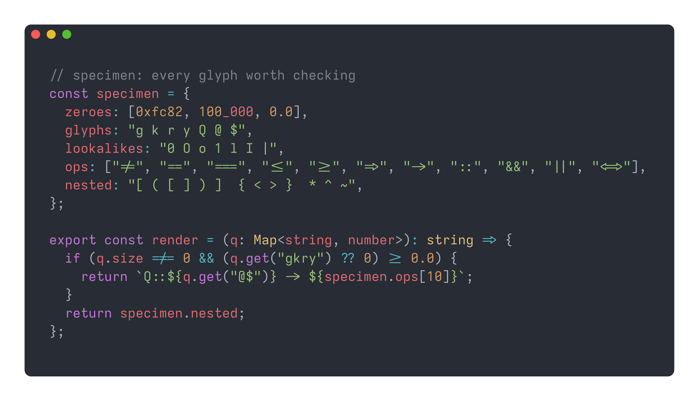
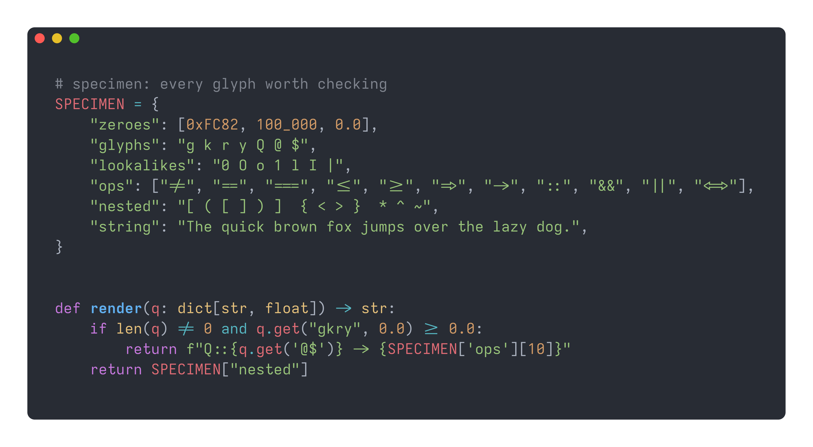
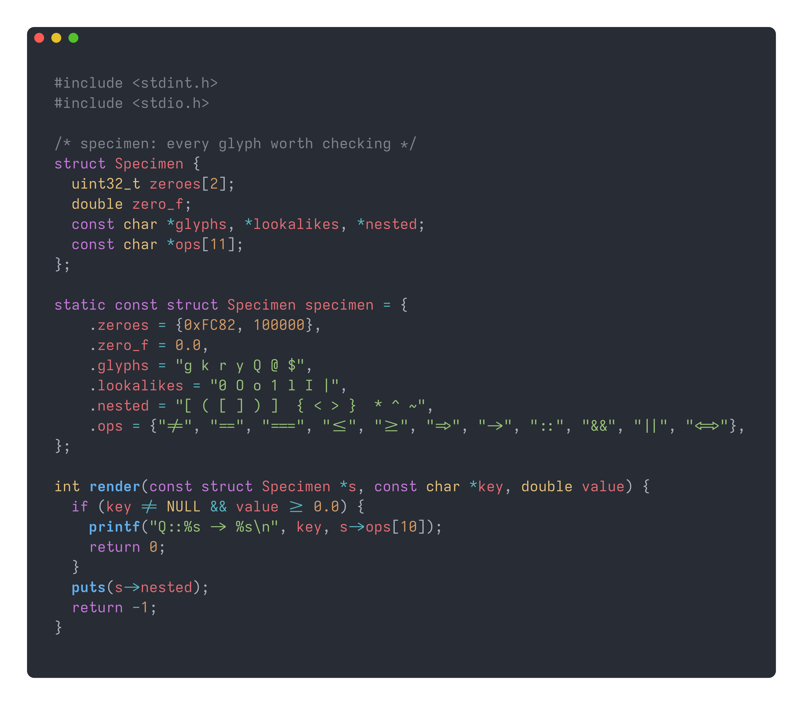
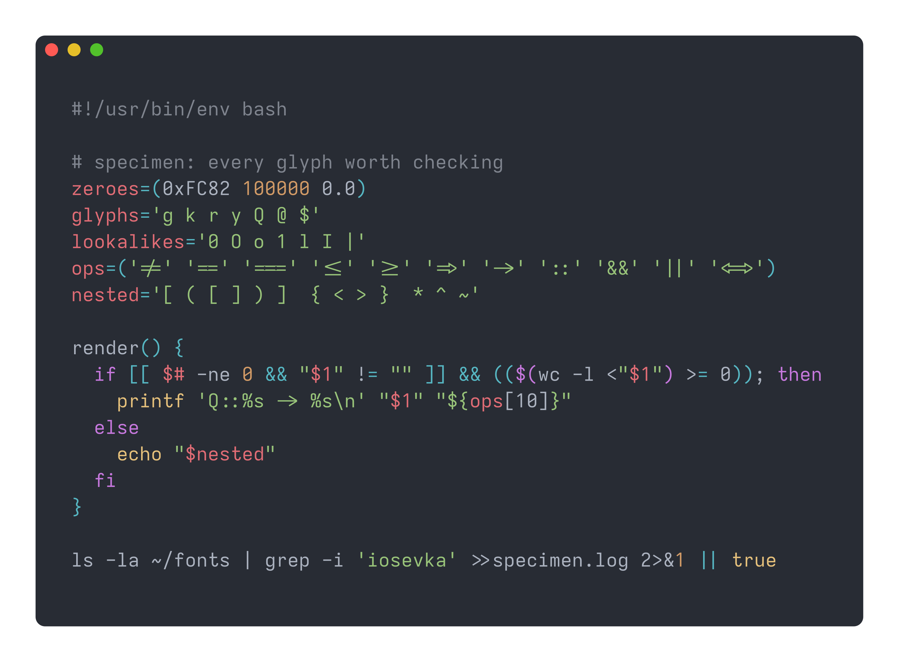

# Iosevka Extended

<p align="center">
  
</p>

## Code Samples

<table align="center">
  <tr>
    <th>TypeScript Sample Code</th>
    <th>Python Sample Code</th>
  </tr>
  <tr>
    <td>
      
    </td>
    <td>
      
    </td>
  </tr>
  <tr>
    <th>C Sample Code</th>
    <th>Bash Sample Code</th>
  </tr>
  <tr>
    <td>
      
    </td>
    <td>
      
    </td>
  </tr>
</table>

> [!NOTE]
> For more screenshots with different programming / markup language(s), head over to the [assets](https://github.com/Sunhaloo/IosevkaExtended/tree/main/assets) directory.

# Backstory

I was simply browsing [programmingfonts.org](https://www.programmingfonts.org/) as one usually does on a random Wednesday night and I came across [Iosevka Extended](https://www.programmingfonts.org/#iosevka-extended).

> My god it was *love at first font* ( *never kissed a woman what do you expect of me* )...

I tried so hard to find **official**, yes *official* download for 'Iosevka Extended' ( *`.ttf` version* ) but could **not** find it at all.

> I know that the `.ttc` format exists for the 'Extended' version but **not** `.ttf`!

Hence, this is why I basically created this "*custom version*" using the original Iosevka Font by using their [online customiser](https://typeof.net/Iosevka/customizer) to get the *build plans* so that I can actually use the font everywhere.

> Hope you enjoy!

# Installation and Usage

## Installation

### Which ZIP file should I download?

- **Hinted** ( `IosevkaExtended-<tag>-Hinted.zip` ): Main font that **most** people should be using as it includes `ttfautohint` for crisper text on low resolution screens like 1366x768 ( mainly on Windows and in apps that use embedded hints ).
- **Unhinted** ( `IosevkaExtended-<tag>-Unhinted.zip` ): Smaller file size, which people on high resolution / high-DPI displays should be using, or when your operating system / application ignores _hinting_.
- **Web** ( `IosevkaExtended-<tag>-Web.zip` ): WOFF2 web fonts for websites.

> [!WARNING]
> 
> > Linux users!
> 
> Either you choose to install it _system-wide_ or _user-wide_ but **not** both!
>
> You would generally use the _user-wide_ installation method if you **don't** have _root_ access to the system that you are on.
>
> But given that on my system I am inside the `sudoers` file; I install my fonts **system-wide** so that I can have all my fonts in a single place.

> [!IMPORTANT]
> Obviously the **web version** of the fonts, i.e. the `*.woff2` extension are **not** going to be *installable*!

### Linux

- Head over to the [releases](https://github.com/Sunhaloo/IosevkaExtended/releases/) page and download the font type of your choice ( _'hinted' or 'unhinted'_ )
- Extract the fonts using the `unzip` command:

```bash
# something like this
unzip IosevkaExtended-<tag>-<type>.zip
```

- Install the font **user-wide**:

```bash
# NOTE: make sure that you already have the `~/.local/share/fonts/` directory

# assuming that you are inside the `~/Downloads` directory
cp -r IosevkaExtended-<tag>-<type>/IosevkaExtended/ ~/.local/share/fonts/

# make the system know that we have added another font
fc-cache -fv

# ( optional ) delete the unwanted files
rm -rf IosevkaExtended-<tag>-<type>.zip IosevkaExtended-<tag>-<type>
```

- Install the font **system-wide**:

```bash
# assuming that you are inside the `~/Downloads` directory
sudo cp -r IosevkaExtended-<tag>-<type>/IosevkaExtended/ /usr/share/fonts/

# make the system know that we have added another font
fc-cache -fv

# ( optional ) delete the unwanted files
rm -rf IosevkaExtended-<tag>-<type>.zip IosevkaExtended-<tag>-<type>
```

### Windows

- Head over to the [releases](https://github.com/Sunhaloo/IosevkaExtended/releases/) page and download the font of your choice ( _'hinted' or 'unhinted'_ )
- Assuming that you are inside the `~\Downloads` folder
  - Simply extract the `.zip` file using the _right-click_ menu like a [normie](https://www.urbandictionary.com/define.php?term=Normie).
- Hence follow this path: `IosevkaExtended-<tag>-<type>\IosevkaExtended\`
- Select all the `*.ttf` fonts, *right-click* and hit the **Install** or **Install for all users**.

## Usage

### Kitty Terminal

- To use the font inside of [Kitty](https://github.com/kovidgoyal/kitty) terminal, simply add the following lines below to the `~/.config/kitty/kitty.conf` file:

```conf
font_family      family="Iosevka Extended"
font_size 14.0
```

### Ghostty Terminal

- Similarly, if you uses [Ghostty](https://github.com/ghostty-org/ghostty) instead, simply add the following lines below to the `~/.config/ghostty/config.ghostty` file:

```conf
font-family = "Iosevka Extended"
font-size = 14
```

### VS Code

> I cannot believe that I am writing this section... Just you [Zed](https://zed.dev/) bro!

- Inside the user `settings.json` file:

```json
{
  "editor.fontFamily": "Iosevka Extended",
  "editor.fontSize": 14
}
```

### Zed Editor

> Yes, use this rather than this piece of Electron garbage above!

```json
{
  // font family
  "ui_font_family": "Iosevka Extended",
  "buffer_font_family": "Iosevka Extended",

  // font size
  "ui_font_size": 14,
  "buffer_font_size": 14,
}
```

---

# Some Notes

## AI Usage

> I think this is what AI should be used for more often than actual coding!

Given that this is not really about learning something and whereby the knowledge will be used over and over again. I basically used [Claude](https://claude.ai)'s help in order to **learn** on how to create an extended version of [Iosevka](https://typeof.net/Iosevka/) and also publish it.

This is what I think AI should be actually doing and automating for us; the menial, annoying work!

Where AI was use primarily was to create the screenshots by making a bash script that use the extremely easy-to-use <code><a href="https://github.com/charmbracelet/freeze">freeze</a></code> CLI tool by [Charm](https://charm.land/).

> Please head over to the following link to view the bash script generated: <https://github.com/Sunhaloo/IosevkaExtended/tree/main/learning/Publishing%20Iosevka%20Extended%20Font.md#the-screenshot-bash-script>

## Do It Yourself

So I am **not** going be writing anything about "_building from source_" or anything like that as I have extensively documented _my_ process for making this custom Iosevka Extended font inside my learning markdown files.

Therefore, if you want to try this by yourself. I suggest you to check out the following link [here](https://github.com/Sunhaloo/IosevkaExtended/tree/main/learning) which is going to redirect you to the `learning` directory.

- Markdown Files:
  - Making The Custom Font: <code><a href="https://github.com/Sunhaloo/IosevkaExtended/tree/main/learning/Iosevka%20Font%20Customiser.md">Iosevka Font Customiser.md</a></code>
  - Publishing on GitHub: <code><a href="https://github.com/Sunhaloo/IosevkaExtended/tree/main/learning/Publishing%20Iosevka%20Extended%20Font.md">Publishing Iosevka Extended Font.md</a></code>
  
## License and Credits

Iosevka Extended is built from [Iosevka](https://typeof.net/Iosevka/) by Renzhi Li (Belleve Invis) and is licensed under the SIL Open Font License 1.1. See [LICENSE.md](./LICENSE.md). Built from Iosevka v34.9.0.
